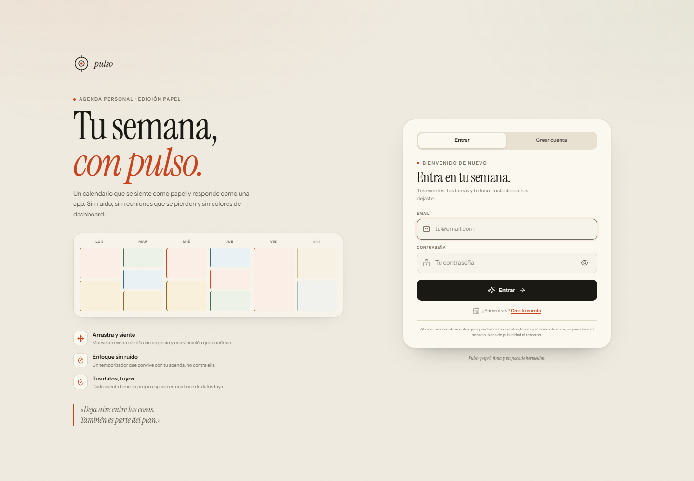
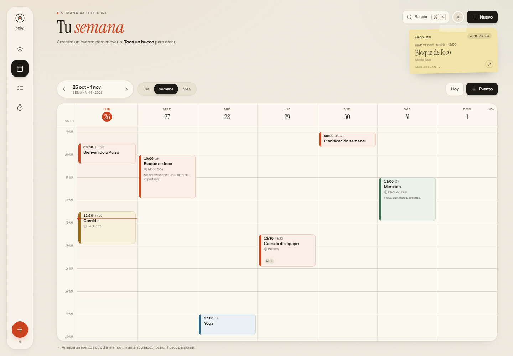
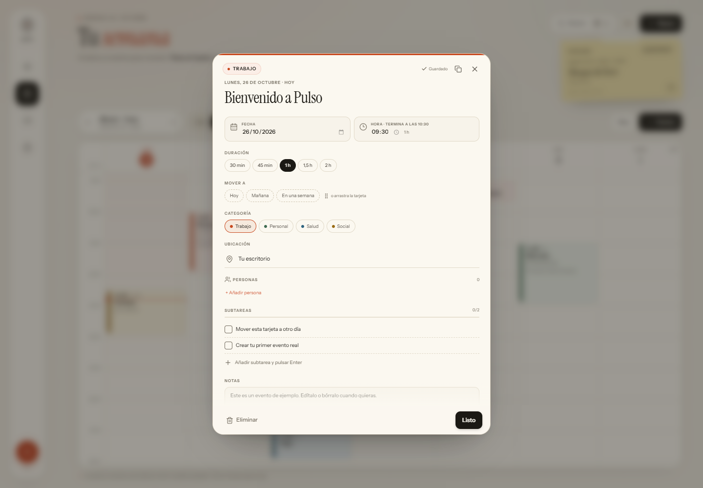
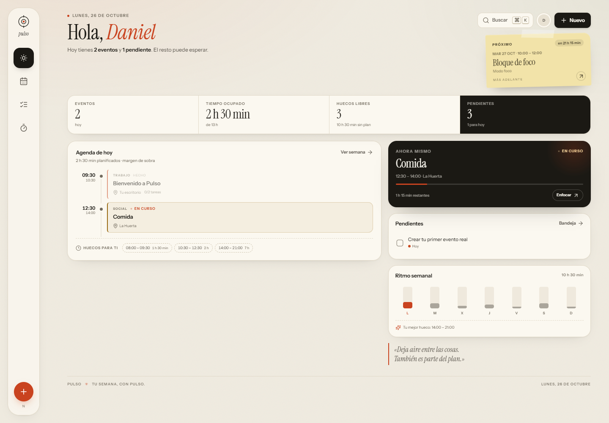
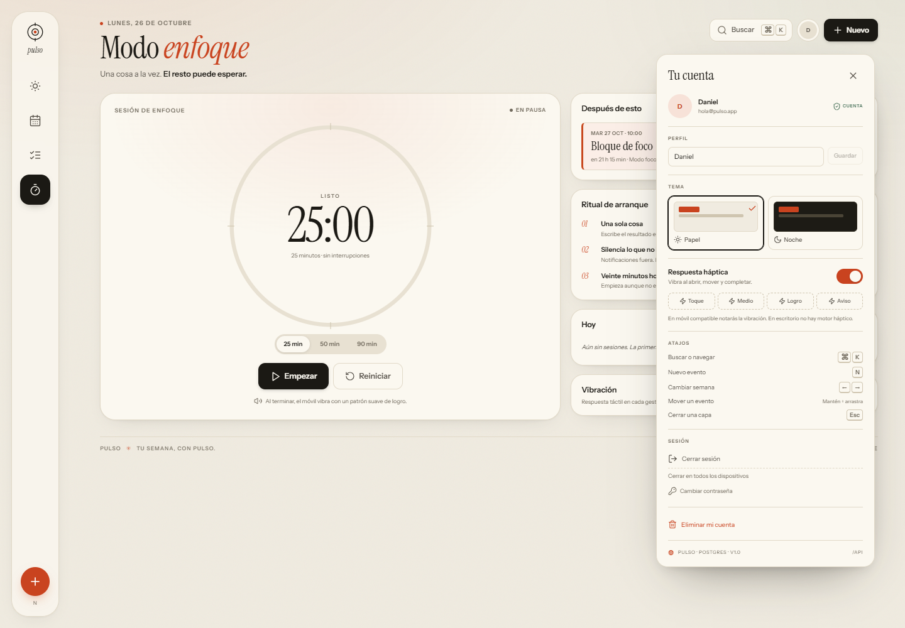
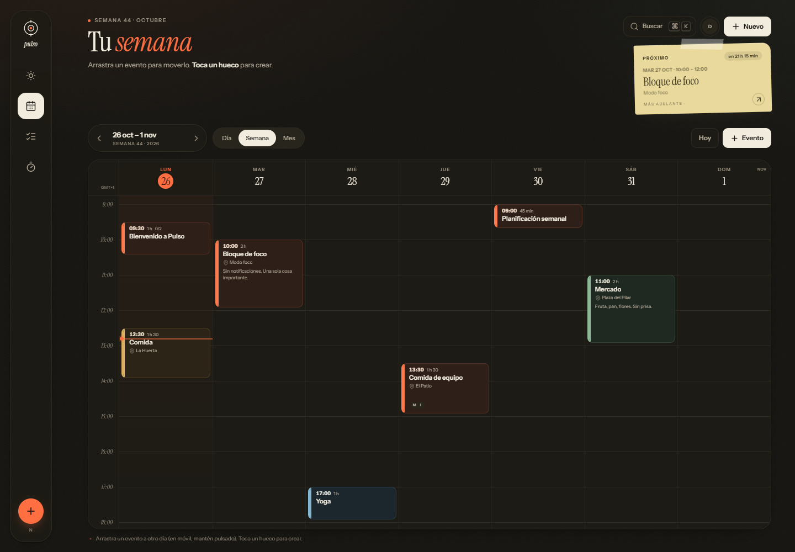
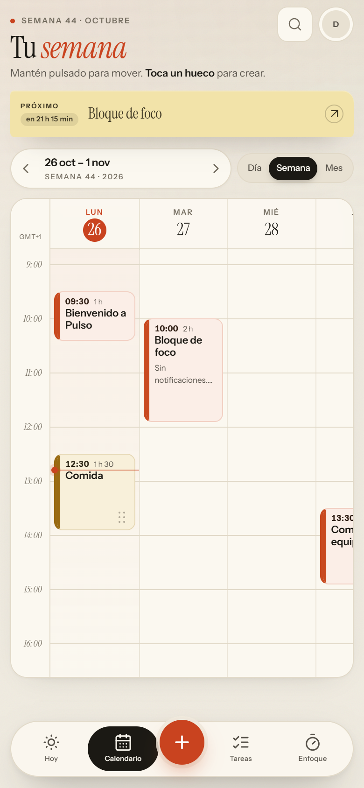
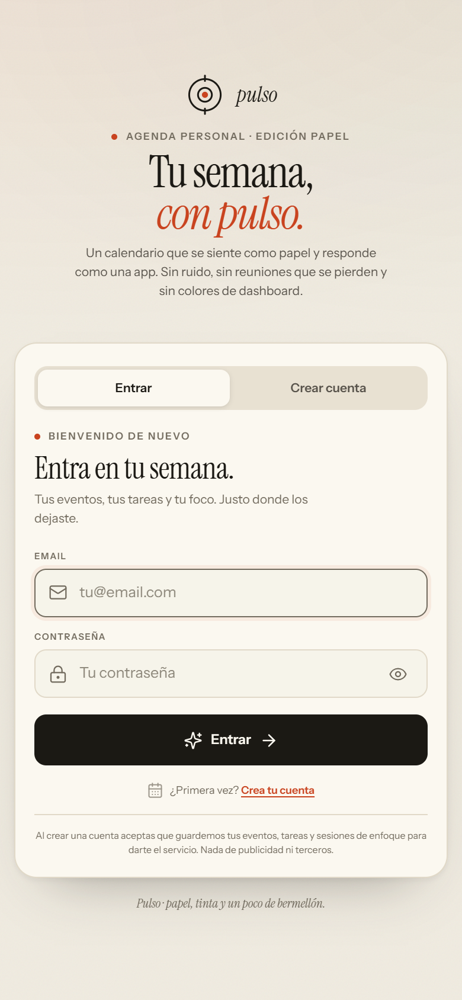

# Pulso

**Agenda personal editorial, ahora de verdad.** Cuentas con contraseña, datos por usuario en PostgreSQL, drag & drop con hápticas y todo empaquetado en Docker. **Este repositorio no despliega nada**: tú decides cuándo y dónde con tu Coolify.

[](https://github.com/mkandreum/messoff/actions/workflows/ci.yml)


Repositorio: [github.com/mkandreum/messoff](https://github.com/mkandreum/messoff)

> Pulso nació del boceto de una agenda de papel. La estética se queda; la capa de juguete (localStorage) se ha sustituido por una API real, sesiones, base de datos y contenedores.

---

## Capturas

| Acceso | Semana |
| --- | --- |
|  |  |
|  |  |
|  |  |
|  |  |

También hay capturas de [enfoque](preview/enfoque-escritorio.png), [detalle móvil](preview/detalle-movil.png), [hoy móvil](preview/hoy-movil.png) y [cuenta móvil](preview/cuenta-movil.png).

---

## Lo que ya es real

### Cuentas y datos
- Registro con nombre, email y contraseña; login, logout y sesión persistente.
- Contraseñas con **bcrypt (coste 12)**. Nunca se devuelven al cliente.
- Sesión con **JWT HS256 en cookie HttpOnly**, `SameSite=Lax`, `Secure` en producción y 60 días de duración.
- `tokenVersion`: cerrar sesión en todos los dispositivos o cambiar la contraseña invalida las sesiones anteriores.
- Cambio de nombre, cambio de contraseña y eliminación de cuenta con confirmación.
- Límite de intentos en login/registro y validación de todos los cuerpos con Zod.
- Cada usuario ve **solo sus eventos, tareas y sesiones de enfoque**. No hay datos compartidos.
- Al crear una cuenta se siembra una semana de ejemplo para que el calendario no esté vacío. `SEED_DEMO=false` lo desactiva.

### Calendario
- Vistas **día, semana y mes**; navegación por semanas/meses y vuelta a hoy.
- Barra inferior en píldora en móvil y raíl vertical en escritorio.
- Hora fija a la izquierda, columna del día actual, línea de "ahora", huecos libres y carga semanal.
- **Drag & drop** con ratón/lápiz inmediato y long press de 300 ms en táctil; asa de puntos en tarjetas con espacio.
- Ajuste a intervalos de 30 minutos, autoscroll, previsualización del hueco, aviso de solapamiento y **Deshacer**.
- Tarjetas densas según duración; los eventos solapados se apilan para seguir siendo legibles.
- Crear tocando un hueco del calendario.

### Detalle del evento
- Hoja flotante con animación compartida (no ocupa toda la pantalla).
- Título, fecha, hora, duración, categoría, lugar, personas, subtareas con progreso y notas.
- Guardado automático, duplicar, eliminar con deshacer y detección de conflictos.
- Reprogramación rápida y accesible (hoy, mañana, +7 días) además del arrastre.

### Bandeja y enfoque
- Tareas con etiquetas, vencimientos, filtros y progreso.
- **Programar** una tarea en el primer hueco libre real de los próximos 14 días.
- Temporizador 25/50/90 min con anillo de progreso y sesiones guardadas en Postgres.
- Paleta de comandos `⌘K` / `Ctrl K`, creación en lenguaje natural ("Café con Lucía mañana 09:30") y atajos de teclado.

### Interfaz
- Modo papel y modo noche con tokens propios.
- Nota física de "próximo evento", tipografía editorial, grano sutil y un único acento bermellón.
- Responsive de 320 px a 1440 px, sin scroll horizontal de página.
- Hápticas con `web-haptics` y panel para probar patrones.
- Accesibilidad: foco visible, trampas de foco en capas, `aria-label`, contraste AA y `prefers-reduced-motion`. Axe sin violaciones en acceso, calendario, cuenta y detalle.

---

## Stack

| Capa | Tecnología |
| --- | --- |
| Web | React 18, TypeScript, Vite, Motion, Lucide |
| API | Node 22, Express 4, Zod, Helmet, rate limit |
| Datos | PostgreSQL 16 + Prisma 6 |
| Auth | bcryptjs, JWT HS256, cookie HttpOnly, CSRF por cabecera |
| Entrega | Docker multi-stage, Docker Compose, GitHub Actions (solo CI) |
| Diseño | CSS propio con tokens, Instrument Serif + Instrument Sans |

No hay Tailwind ni una librería de componentes: el sistema visual vive en `src/styles.css` y sigue el lenguaje de **shadcn/ui** (el sistema de componentes con más estrellas de GitHub) y los patrones de accesibilidad de Radix. Las animaciones son de **Motion** y la vibración de **web-haptics**.

---

## Arrancar en local

### Todo con Docker (recomendado)

```bash
cp .env.example .env
# Edita .env:
#   JWT_SECRET=$(openssl rand -base64 64)
#   POSTGRES_PASSWORD=algo-largo
#   APP_ORIGIN_PUBLIC=http://localhost:3000
#   COOKIE_SECURE_PUBLIC=false
docker compose -f docker-compose.yml -f docker-compose.local.yml up -d --build
```

Abre `http://localhost:3000` y crea una cuenta. El calendario llega con datos de ejemplo.

El `docker-compose.yml` base **no publica el puerto en el host**: está pensado para Coolify/Traefik, que entra por la red interna al puerto `3000`. El archivo `docker-compose.local.yml` añade el mapeo `127.0.0.1:3000` solo para tu máquina.

- Logs: `docker compose -f docker-compose.yml -f docker-compose.local.yml logs -f app`
- Parar: `docker compose -f docker-compose.yml -f docker-compose.local.yml down`
- Borrar también la base de datos: `docker compose -f docker-compose.yml -f docker-compose.local.yml down -v`
- Salud: `http://localhost:3000/api/health`

### Desarrollo con Vite, API aparte

Necesitas un PostgreSQL en `localhost:5432`.

```bash
cp .env.example .env
docker compose -f docker-compose.dev.yml up -d

npm install
npx prisma migrate deploy
npm run dev
```

- Web: `http://localhost:5180`
- API: `http://localhost:3001/api/health`
- Vite hace proxy de `/api` al API.
- El `DATABASE_URL` del `.env` debe coincidir con el usuario/password que levanta `docker-compose.dev.yml`.
- Si ya tienes un Postgres, salta el compose y apunta `DATABASE_URL` a él.

### Pruebas

```bash
npm run test:api
npm run typecheck
npm run build
```

Las pruebas de API cubren registro, sesión, CSRF, CRUD de eventos, duplicado, programación de tareas, cambio de contraseña, borrado de cuenta y sesiones de enfoque. En CI se ejecutan contra un servicio PostgreSQL 16.

---

## Variables de entorno

| Variable | Para qué | Notas |
| --- | --- | --- |
| `JWT_SECRET` | Firma de sesiones | 32+ caracteres. En producción es obligatorio. |
| `POSTGRES_USER` / `POSTGRES_PASSWORD` / `POSTGRES_DB` | Base de datos de Compose | El contenedor construye `DATABASE_URL` con la contraseña codificada. |
| `DATABASE_URL` | Postgres externo o desarrollo | Si existe, el entrypoint no construye la URL de Compose. |
| `APP_ORIGIN_PUBLIC` | URL pública | Compose la mapea a `APP_ORIGIN`; con HTTPS en producción. |
| `COOKIE_SECURE_PUBLIC` | Marca la cookie como Secure | `true` en producción con HTTPS. |
| `SEED_DEMO` | Datos de ejemplo al registrarse | `true` por defecto. |
| `TZ` | Zona horaria del servidor | `Europe/Madrid` por defecto. |
| `APP_PORT` | Puerto del mapeo local (`docker-compose.local.yml`) | `3000`; no se usa en Coolify. |
| `PORT` | Puerto interno de la API | `3000` en Docker, `3001` en desarrollo. |

En desarrollo, el `.env.example` trae `APP_ORIGIN=http://localhost:5180`, `PORT=3001` y `COOKIE_SECURE=false`.

---

## Despliegue (lo haces tú)

El workflow [`.github/workflows/ci.yml`](.github/workflows/ci.yml) **no despliega nada y no publica imágenes**. Solo comprueba que el proyecto está sano:

1. **Web**: instala, comprueba tipos, construye el frontend y audita dependencias de producción.
2. **API**: levanta PostgreSQL 16, aplica migraciones, ejecuta las pruebas y compila el servidor.
3. **Docker**: construye la imagen localmente (`pulso:ci`) y la descarta al terminar.

No hay webhook, ni secreto de Coolify, ni push a un registro. El despliegue es una decisión tuya.

### Coolify

1. Crea un recurso nuevo desde este repositorio:
   - **GitHub repository** + Dockerfile, o
   - **Docker Compose** usando `docker-compose.yml`.
2. Si usas Postgres gestionado, define `DATABASE_URL`. Si usas el `docker-compose.yml`, Coolify levanta `db` y `app` juntos.
3. Configura las variables:
   ```
   JWT_SECRET=<64 caracteres>
   APP_ORIGIN_PUBLIC=https://tu-dominio.com
   COOKIE_SECURE_PUBLIC=true
   SEED_DEMO=true
   TZ=Europe/Madrid
   ```
   Si usas la base de datos del compose, añade también `POSTGRES_USER`, `POSTGRES_PASSWORD` y `POSTGRES_DB`.
4. **No publiques el puerto 3000 en el host.** El compose base usa `expose: 3000`; Coolify/Traefik entra por la red interna. Si Coolify te pide el puerto del contenedor, es `3000`; no añadas un `ports: 3000:3000` (fue lo que chocó con el puerto ya ocupado de tu servidor).
5. Añade el dominio en Coolify apuntando al puerto `3000` y activa HTTPS.
6. Despliega desde Coolify cuando quieras. Si activas el auto-deploy de Coolify para este repo, será Coolify quien lo dispare, no GitHub Actions.

También puedes desplegar en un VPS:

```bash
git clone https://github.com/mkandreum/messoff.git
cd messoff
cp .env.example .env   # edita los secretos, APP_ORIGIN_PUBLIC y COOKIE_SECURE_PUBLIC
# Publica solo en 127.0.0.1:3000 para que Caddy/Nginx haga de proxy.
docker compose -f docker-compose.yml -f docker-compose.local.yml up -d --build
```

Pon Caddy/Nginx/Traefik delante para HTTPS. No incluyo backups automáticos: configura una copia de `pulso_pgdata` o `pg_dump` en tu proveedor.

---

## Seguridad y sesiones

- Contraseñas: bcrypt coste 12, mínimo 8 caracteres.
- Login: respuesta genérica y comparación con un hash ficticio para no filtrar emails.
- Sesión: JWT HS256, `sub` + `tokenVersion`, cookie HttpOnly de 60 días.
- Mutaciones con cookie: exigimos `X-Requested-With: XMLHttpRequest`, sin CORS y con `SameSite=Lax`.
- Rate limit en login/registro (10 intentos / 15 min) y en la API.
- Todas las consultas de eventos/tareas/foco filtran por `userId`.
- Helmet + CSP + compresión; límite de cuerpo de 128 KB.
- Borrar cuenta elimina en cascada eventos, tareas y sesiones.
- No hay verificación de email ni recuperación de contraseña: requieren SMTP y quedan como siguiente paso. Tampoco hay 2FA.

El rate limit es en memoria, suficiente para una instancia. Si escalas a varias réplicas, cámbialo a Redis.

---

## Modelo de datos

```
User ──< Event ──< ChecklistItem
  ├──< Task
  └──< FocusSession
```

- `Event.date`: `YYYY-MM-DD` como texto para no desplazar el día por zonas horarias.
- `Event.start`: minutos desde medianoche; `duration`: minutos.
- `Event.checklist`: relación ordenada por `position`.
- `Task.due`: `YYYY-MM-DD` o null.
- `FocusSession.completedAt`: timestamp del servidor.

Endpoints principales:

```
POST   /api/auth/register        POST /api/auth/login
POST   /api/auth/logout          GET  /api/auth/me
PATCH  /api/auth/me              PATCH /api/auth/password
POST   /api/auth/logout-all      POST /api/auth/delete
GET    /api/bootstrap
GET    /api/events               POST /api/events
PATCH  /api/events/:id           DELETE /api/events/:id
POST   /api/events/:id/duplicate
GET    /api/tasks                POST /api/tasks
PATCH  /api/tasks/:id            DELETE /api/tasks/:id
POST   /api/tasks/:id/schedule
GET    /api/focus-sessions       POST /api/focus-sessions
GET    /api/health
```

---

## Hápticas

Patrones expuestos en el panel de cuenta:

| Gesto | Patrón | Sensación |
| --- | --- | --- |
| Navegar / tocar | `selection` | microtoque |
| Empezar a arrastrar | `medium` | confirmación |
| Soltar en un día | `success` | doble pulso |
| Cancelar | `warning` | aviso suave |
| Completar tarea o foco | `success` | refuerzo |
| Eliminar | `error` | tres toques secos |

En Android funciona con `navigator.vibrate`; en iOS Safari, `web-haptics` usa el truco del input switch. En escritorio no hay motor háptico: el panel lo explica y permite probar los patrones sin fingir vibración.

---

## Estructura

```
src/                    frontend React
  auth.tsx              sesión, login/registro, perfil
  state.tsx             datos por usuario + acciones optimistas
  lib/api.ts            cliente fetch con CSRF y manejo de 401
  components/           calendario, hoja, tareas, foco, cuenta...
  styles.css            sistema visual completo
server/
  src/app.ts            Express + Helmet + rutas + estáticos
  src/auth.ts           bcrypt, JWT, cookie, CSRF, rate limit
  src/routes/           auth, events, tasks, focus, bootstrap
  src/seed.ts           semana de ejemplo al registrarse
  test/api.test.ts      pruebas de integración con Postgres
prisma/                 schema + migración inicial
.github/workflows/ci.yml
Dockerfile              multi-stage, usuario no root, migraciones al arrancar
docker-compose.yml      app + Postgres + healthchecks
docker-compose.dev.yml  solo Postgres para desarrollo local
docker-entrypoint.sh    URL de BD + prisma migrate deploy
preview/                capturas de la app real
```

---

## Diseño

La dirección sigue siendo la del prototipo: papel cálido, tinta, hairlines, tipografía de revista y un único bermellón. La cuenta añade una portada editorial con una mini-semana de colores; el detalle mantiene la hoja flotante con morph desde la tarjeta.

- Fuentes locales: **Instrument Serif** para titulares/cifras y **Instrument Sans** para la interfaz. Ambas bajo SIL OFL 1.1; licencias en `src/fonts/`.
- Tokens de color, radios, sombras y tipografía en `:root` y `[data-theme="night"]`.
- La barra de navegación es una píldora en móvil y un raíl vertical en escritorio.
- Las capturas de `preview/` están hechas con la app real y una cuenta de demostración.

---

## Límites conocidos

- Sin verificación de email, recuperación de contraseña ni 2FA.
- Sin eventos recurrentes ni calendarios múltiples/compartidos.
- Sin sincronización en tiempo real entre dispositivos (recargar trae los datos).
- El temporizador de enfoque sigue corriendo solo mientras la vista está montada; las sesiones ya completadas sí quedan en la base de datos.
- Rate limit en memoria; para varias réplicas, Redis.
- Los datos de ejemplo se crean al registrarse; se pueden borrar a mano.
- Backups de Postgres no incluidos en el compose.

---

Hecho para que lo toquen, lo muevan y lo sientan.
